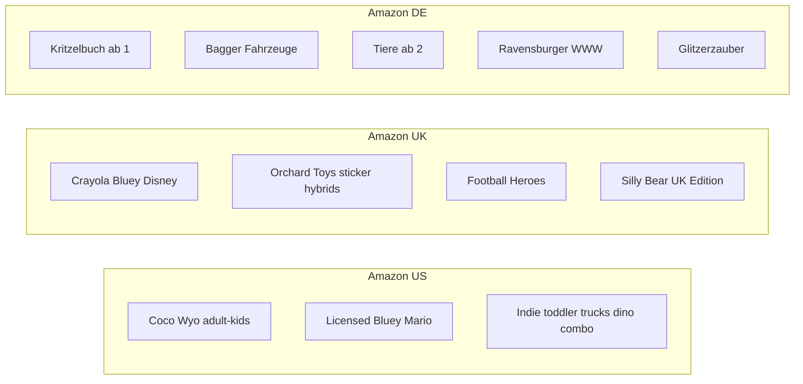

# Decision report — Kids coloring book themes that sell on Amazon

**Date:** 2026-08-20  
**Markets:** Amazon.com, Amazon.co.uk, Amazon.de  
**Ages:** 2–12  
**Question:** Which 6–10 themes should a solo, unbranded KDP publisher produce first so a *new* listing can actually move copies?

**Not answered here:** guaranteed BSR, search-volume integers (no Keepa / Helium10 / Publisher Rocket), or Google Trends relative ranking (direct Trends fetch returned 429/timeout). Reddit r/KDP was blocked.

---

## Verdict

Produce **age-banded toddler and vehicle books first**, not “a kids coloring book.”

The category is growing. Circana BookScan via Publishers Weekly (Aug 14, 2026): children’s activity print **16.7 million units in 2025, +18%**, vs +3% for children’s overall; still +18% YTD through May 23, 2026 ([11](sources/11_pw_circana_activity_books_2026.md)). Parents are hunting screen-free activities ([12](sources/12_circana_2026_book_trends.md), [20](sources/20_pinterest_parenting_trend_report_2026.md)).

That growth is **captured**. A quarter of US coloring-book units this year are **Coco Wyo** ([11](sources/11_pw_circana_activity_books_2026.md)). On 2026-08-20, Amazon US Children’s Coloring Books (node **3374**) #1 and #2 are Cozy Cuties / Cozy Corner, both titled “for Adults and Kids” ([01](sources/01_amazon_us_childrens_coloring_bestsellers_3374.md)). The rest of the top 20 is licensed Bluey, Mario-adjacent, KPop Demon Hunters, Melissa & Doug water-reveal, Paint by Sticker Official, and School Zone — plus one animals coloring book for ages 4+.

Fast sales for *you* means: a parent-searchable theme Amazon already buys **without a license**, an age callout on the cover, thick lines for 2–6, original interiors, print-only, list price **≥ $9.99 / €9.99 / £7.99** after the June 2025 royalty cut ([17](sources/17_kdp_print_royalty_change_2025.md)), and no Disney/Bluey/Frozen smell.

If the book is generic AI dinosaurs at $6.99 with no ads and no unique art, it will not sell fast. That outcome is documented, not theoretical ([19](sources/19_kdp_community_32_books_no_sales_2025.md), [21](sources/21_mari_kii_kdp_coloring_launch_failure.md)).

---

## Produce-first shortlist (8)

Order is “highest chance of first organic sales in 30 days *if* cover, age-band, and interiors are executed.” Not a promise.

| # | Theme | Primary age | Why it clears the bar | Risk |
|---|---|---|---|---|
| 1 | **Toddler bold/easy multi-theme** (animals + vehicles + everyday objects; thick lines; one large image per page) | 2–5 | US #44 Simple & Big Toddler; NR #25 thick-bold-lines ages 2–5; UK 7.7K reviews on the same title pattern; activity-list #7 is a 128-page perforated toddler multi-theme book | Format is crowded; cover must scream AGE 2–5, not “cozy adult” |
| 2 | **Trucks / construction / “everything that goes”** | 2–5 (expand 4–8 later) | US #42 Truck Coloring Book; #33 Construction Site preschool; DE Malbuch Bagger + Fahrzeuge ab 3; UK construction+alphabet mashup | Boys-skewed; keep original vehicles, no Bob the Builder / Paw Patrol construction crew |
| 3 | **Dinosaurs — jumbo / toddler / facts**, not generic “dino 4–8” | 2–4 first | NR #7 Jumbo Dinosaur Toddlers ages 2–4; dino SERP is mostly indie (rankable) but dense | Generic 4–8 T-Rex books are oversupplied; licensed-free ≠ easy |
| 4 | **Animals** (cute, one species cluster or “baby animals,” not 200 random clip-art) | 4–8 and 2–5 split | US #6 Big Book of Colouring: Animals Ages 4+; DE Tiere Malbuch ab 2 | Broadest evergreen; needs a sharper subtitle than “animals” |
| 5 | **Unicorn + mermaid + fairy combo** (not Frozen princess) | 4–8 (birthday “I am 3 / I am 4” variants) | US #47 combo title; unicorn SERP is combo-dominated; NR #14/#19 age-gift unicorn-mermaid-princess | Princess language drifts toward Disney; never Elsa/castle-IP |
| 6 | **ABC / alphabet with objects** (letters + animals/vehicles) | 3–5 | US #16 toddler ABC head-start; UK ABC 4.4K reviews; School Zone workbooks prove parent educational buy-intent | Compete with workbooks; stay coloring, add letter on page, don’t fake a curriculum |
| 7 | **Dot marker / big-dot animals** | 2–5 | US #27–#28 in the coloring node | Different interior spec (huge dots); Sesame Street already occupies licensed dot-marker |
| 8 | **Halloween — cute kids, not adult Spooky Cutie** | 2–8 | Already on US new releases (Disney Halloween, School Zone spooky workbook, indie Boo-Ville). ~10 weeks to Oct 31 | Must list by mid-September 2026 or miss the window; Disney owns the licensed slot |

**Second wave (do not start here):** ocean/sharks preschool (NR #11), farm (NR only, absent US bestsellers top 50), DE-only Kritzelbuch/Kindergarten-Freunde formats if you localize interiors, UK football (licensed-adjacent heroes brand), Christmas (produce in October, not this week).

---

## Do-not-touch

- **Licensed anything:** Bluey, Disney, Frozen/Elsa, Paw Patrol, Peppa, Mario, Pokémon, Sesame, Minecraft official, KPop Demon Hunters, Ms. Rachel. “Inspired by” included ([13](sources/13_kdp_content_guidelines.md), [15](sources/15_kdp_ip_faq.md)).
- **Generic keyword `kids coloring book` / `Ausmalbuch Kinder` as the whole product.** Search is Disney/Bluey/Crayola + Coco Wyo ([04](sources/04_amazon_us_search_kids_coloring_book.md), [07](sources/07_amazon_uk_search_kids_colouring.md), [09](sources/09_amazon_uk_bestsellers_sort_contamination.md)).
- **Adult cozy / bold-and-easy titled “for adults and kids” as a kids first title.** That is Coco Wyo’s 25% unit share, not the 4-year-old parent query.
- **Space as SKU #1.** Only showed as a boys multi-theme add-on (#43). Affiliate blogs oversell it ([22](sources/22_kdpeasy_kids_coloring_affiliate.md)).
- **Farm as US SKU #1.** Not in bestsellers top 50. Fine as DE/UK later.
- **eBook coloring.** Official quality guide: coloring books are not suited to Kindle format ([16](sources/16_kdp_kindle_content_quality.md)).
- **Low-content checkbox.** Coloring books are *not* low-content ([14](sources/14_kdp_low_content_books.md)).
- **32-book AI spray at $6.99.** Dec 2025 community: zero sales; “hand drawn” on AI is a complaint/account risk ([19](sources/19_kdp_community_32_books_no_sales_2025.md)).

---

## Hypothesis scorecard

| ID | Claim | Judgment | Why |
|---|---|---|---|
| **H1** Evergreen volume = animals, dinos, unicorns/mermaids, vehicles, farm/pets | **Partially confirmed** | Animals, dino, unicorn-combo, trucks/construction are on US/UK/DE lists. Farm is weak on US bestsellers. Space is weak. Mermaids sell as combo, not standalone. Google Trends comparison **empty** ([25](sources/25_google_trends_direct_fetch_failed.md)). |
| **H2** Age-banded niches rank faster than generic | **Confirmed as a visibility pattern; conversion-for-new-ASINs under-determined** | Generic SERP is licensed+cozy. Age-banded titles occupy theme SERPs and node 3374. No sales telemetry on *new* publishers. Forum: unique + marketed or nothing ([19](sources/19_kdp_community_32_books_no_sales_2025.md)). |
| **H3** Seasonal ≠ first year-round SKU | **Confirmed, with a dated exception** | Halloween is already on new releases (Aug 20). Christmas is the November spike (weak Accio Trends). First catalog title should still be evergreen; Halloween is a justified *parallel* SKU because the window is open now. |
| **H4** Licensed BSR is a trap | **Confirmed** | Lists + PW licensed C&A + KDP IP FAQ. |
| **H5** Format = theme for 2–6 | **Confirmed as list language; not an A/B test** | Thick/jumbo/simple/big/dot-marker/perforated recur. Adult bold-easy contaminates the kids node — do not misread Coco Wyo as toddler demand. |

---

## Marketplace divergence

- **US:** Cozy crossover + licensed + a thin indie band of toddler/trucks/animals/unicorn-combo.
- **UK:** Licensed Crayola/Disney still win generic search; indie wins on toddler simple/big, construction+ABC, Silly Bear; football is UK-only.
- **DE:** Lower licensed share on generic Ausmalbuch than US/UK. Vehicles/Bagger and Kritzelbuch are the local evergreens. Do not copy a US princess cover into DE as SKU #1.

A single interior can ship all three stores if you localize title/keywords (colouring / Ausmalbuch / Bagger / Fahrzeuge) and avoid US-only slang.

---

## Scoring notes (method)

Demand = presence on US 3374 / 3373 / new-releases 3374, plus UK/DE theme SERPs. Rankability = share of captured top results that are unlicensed indie vs Disney/Bluey/Crayola. IP = trademark adjacency. Seasonality = evergreen vs spike. Production = one person, original line art, print paperback.

**Missing:** overall Books BSR integers (product pages blocked), Keepa history, Amazon search volume. Review counts on UK/DE SERPs are a weak velocity proxy only.

---

## Adversarial pass

**Q1. Did we confuse adult bold-and-easy with kids demand?**  
Yes, the *category* confuses them. We split them. Coco Wyo is scored as contamination, not a kids produce-first theme. Spooky Cutie is adult Halloween, not a kids Halloween SKU.

**Q2. Did we treat KDP-tool blogs as market data?**  
No. [22](sources/22_kdpeasy_kids_coloring_affiliate.md), [23](sources/23_coloringbook_dev_niches_2026_affiliate.md), [26](sources/26_lessoncraftstudio_kids_niches_affiliate.md) are credibility 2/5, used as seeds. Ranking comes from Amazon snapshots + PW/Circana + KDP policy + community.

**Q3. Did we recommend a theme whose top 10 is all 5,000-review licensed books?**  
Generic kids coloring: yes that trap exists — it is on the do-not-touch list. Dinosaur, toddler simple/big, trucks, ABC: captured tops are mixed indie/trade, not a Disney wall.

**Q4. Did we overfit US?**  
UK football and DE Bagger/Kritzelbuch are called out. Farm is a DE/UK maybe, not a US first title. Space stays off the shortlist despite US affiliate blogs.

**Steel-man against entering at all:** Kids coloring in 2026 is professionally contested retail. Circana growth flows to Coco Wyo and license holders. June 2025 cut the 50% royalty on the old $6.99 kids price. New ASINs index by exact title, not head terms. Parents can print unicorns for free ([19](sources/19_kdp_community_32_books_no_sales_2025.md)). A first book can do what Mari’s did: ads that lose money, BSR in the millions ([21](sources/21_mari_kii_kdp_coloring_launch_failure.md)) — her niche was wrong, the discovery wall is still real.

**Why enter anyway (narrow):** The unlicensed toddler/vehicle/dino-toddler band is visible *on the actual kids coloring node*, not only in guru blogs. Consumable category (PW: “insatiable”). Screen-free parent motivation is independently confirmed. The play is a small catalog of sharp SKUs at ≥$9.99 with original thick-line art — not a 32-title AI farm.

---

## What a new listing can realistically expect in 30 days

- **If you ship SKU #1 as generic kids coloring / licensed-adjacent / AI-thin:** likely zero sales. That is the base rate in community evidence.
- **If you ship toddler trucks or jumbo dino 2–4 with age on cover, original interiors, print, $9.99+, exact-title indexing, no ads:** first sales are possible but not probable. Plan for a quiet month.
- **If you add a Halloween kids title live by mid-September 2026:** that is the only near-term *velocity* shot in this calendar. Miss mid-September and skip to Christmas production in October.
- **Do not** publish coloring as eBook. **Do** disclose AI if you use it; prefer hand-drawn or heavily original line work so you are not competing with the dump that parents already distrust.

---

## Source-type triangulation

| Thesis | Primary Amazon | Official/legal | Industry/news | Discussion |
|---|---|---|---|---|
| Category growing, share captured | 01, 02 | — | 11, 12 | — |
| Licensed trap | 01, 04, 07 | 13, 15 | 11 | — |
| Indie theme clusters | 01, 02, 05, 06, 08, 10 | — | 23 seed only | 18, 19 |
| Seasonal Halloween | 02, 08 | — | 24 weak | — |
| Format 2–6 | 01, 02, 03, 08 | — | 26 seed | 19 |
| Economics / AI | — | 13, 14, 16, 17 | — | 19, 21 |

H1’s farm/space pieces and all Google Trends relatives: **insufficient evidence**.
